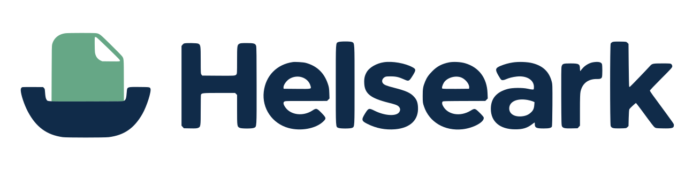

# Helseark

<picture>
  <source media="(prefers-color-scheme: dark)" srcset="docs/brand/png/helseark-horizontal-reverse-1280.png">
  
</picture>

Personal health records can scatter across lab reports, PDFs and portals.
Helseark helps you turn those sources into structured records you can keep,
query and correct.

Today, an agent you choose can help draft records and answer questions from
supplied files. Helseark provides instructions and schemas for that work.
You review every draft before acceptance.

Keep your records in files you control. Choose what to share and which tools can
read them. Preserve sources and backups so your history can outlast any one app
or provider.

- Keep source citations, exact values, units and dates with each record.
- Trace answers to evidence in the records you supply.
- Correct mistakes with a new version. Preserve sources and earlier accepted records.

The starter kit contains instructions, three prompts, [FHIR R4](https://hl7.org/fhir/R4/)
schemas and an invented example. FHIR is an open standard for exchanging health data.
Read the [FHIR introduction](https://hl7.org/fhir/R4/summary.html) to learn more.
Use a text editor or an agent you choose. No installation or model account is required.

**[Start with the starter kit](starter-kit/README.md).**

- [Learn with a cited record](starter-kit/tutorial.md).
- [Extract, query or correct records](starter-kit/how-to.md).
- [Check instructions and schemas](starter-kit/schemas.md).
- [Understand evidence and human review](starter-kit/explanation.md).

Keep sources and accepted history unchanged. Check person identity, precision
and citations before human approval. This kit provides no medical advice.
See [privacy boundaries](docs/explanation/privacy-and-agent-boundaries.md) before sharing records.

The [experimental CLI](docs/optional-cli.md) is optional and has separate limits.
See [current scope](SCOPE.md). No release readiness or clinical correctness is claimed.

[Help](SUPPORT.md) · [Contribute](CONTRIBUTING.md) · [Security](SECURITY.md) ·
[MIT License](LICENSE) · [Third-party terms](docs/maintainers/licensing.md)
