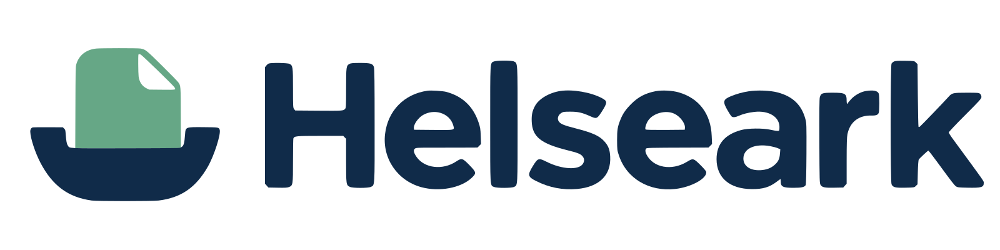

# Helseark brand assets — Quiet Ark

Quiet Ark is Helseark's selected logo: a navy vessel carrying a sea-green folded document. Use the horizontal color logo by default and the symbol alone where space is limited.



All assets are available directly in this directory. [Browse the asset inventory](manifest.json).

## Choose an asset

| Use | Asset | Aspect / dimensions |
| --- | --- | --- |
| README, documentation, site header | [Horizontal logo](svg/helseark-horizontal-color.svg) | 4:1 |
| Covers, square placements | [Stacked logo](svg/helseark-stacked-color.svg) | 1:1 |
| Typography-only placement | [Wordmark](svg/helseark-wordmark-color.svg) | 4:1 |
| Avatar, app icon, small badge | [Symbol](svg/helseark-icon-color.svg) | 1:1 |
| Link previews | [Social card](banners/helseark-social-light.png) | 1200 × 630 |
| Repository social preview | [Repository card](banners/helseark-repository-light.png) | 1280 × 640 |
| Wide documentation or website banner | [Banner](banners/helseark-banner-light.png) | 2560 × 640 |
| Portrait cover / announcement | [Portrait](banners/helseark-portrait-light.png) | 1080 × 1350 |
| Browser tab | [SVG favicon](favicon/favicon.svg), [ICO favicon](favicon/favicon.ico) | Scalable; ICO contains 16, 32, 48, 64, 128, 256 px |
| iOS home screen | [Apple touch icon](favicon/apple-touch-icon.png) | 180 × 180, opaque |
| Web app | [Manifest](favicon/site.webmanifest), [maskable icon](favicon/maskable-512.png) | 192 / 512 px; maskable 512 px |

All four logo layouts are supplied in `color`, `reverse`, `black`, and `white` variants. Reverse uses white lettering and a lighter green page for dark backgrounds. Banners have both `light` and `dark` versions.

## Formats and resolutions

- `svg/`: scalable, editable vector paths with outlined lettering; no installed fonts, linked images, scripts, or network requests.
- `png/`: transparent, antialiased exports. Horizontal and wordmark widths: 320, 640, 1280, 2560, 4096 px. Stacked squares: 256, 512, 1024, 2048 px. Symbol squares: 16, 24, 32, 48, 64, 96, 128, 180, 192, 256, 512, 1024 px.
- `webp/`: lossless transparent exports at each layout's largest PNG resolution.
- `jpg/`: opaque exports at each layout's largest resolution, on warm paper or navy backgrounds.
- `tiff/`: opaque LZW-compressed exports at each layout's largest resolution, tagged at 300 dpi for print workflows.
- `pdf/`: vector artwork, transparent background, outlined lettering.
- `eps/`: vector artwork on warm paper or navy backgrounds; EPS has no alpha transparency.
- `banners/`: exact-size PNG, JPEG, and lossless WebP exports with opaque backgrounds.
- `favicon/`: an adaptive light/dark SVG, monochrome Safari pinned-tab SVG, multi-resolution ICO, PNG, Apple touch icon, maskable icon, and a portable web app manifest.

Use SVG or PDF for print and arbitrary scaling. All colors are RGB/sRGB; these files are not press-specific CMYK separations. A printer should convert the vector master using its requested output profile. PDF/EPS masters have a natural size based on 96 px/in; scale them as required without losing detail. Raster exports include pixel dimensions in `manifest.json`; printing them at 300 dpi does not add detail.

## Color and placement

| Color | Hex | Role |
| --- | --- | --- |
| Navy | `#102B49` | Vessel and primary lettering |
| Sea green | `#66A786` | Folded page on light backgrounds |
| Light sea green | `#82C3A3` | Folded page on dark backgrounds |
| Warm paper | `#FAF8F3` | Light opaque backgrounds |
| White / black | `#FFFFFF` / `#000000` | Reversed and single-ink artwork |

Preserve proportions and the supplied clear space. Use the icon instead of shrinking a wordmark below legibility. Prefer the symbol at 16–48 px. Use reverse or white artwork on dark surfaces; white assets are intentionally invisible on white backgrounds. Do not add shadows, gradients, outlines, or rearrange the page and vessel. The page fold is a transparent cutout.

## Embed in documentation or a site

```html
<picture>
  <source media="(prefers-color-scheme: dark)" srcset="docs/brand/svg/helseark-horizontal-reverse.svg">
  
</picture>
```

For a website, copy the contents of `favicon/` together into your public assets directory and adjust these URLs to match that directory. Manifest icon URLs are relative to the manifest file.

```html
<link rel="icon" href="/favicon.ico" sizes="any">
<link rel="icon" href="/favicon.svg" type="image/svg+xml">
<link rel="apple-touch-icon" href="/apple-touch-icon.png">
<link rel="mask-icon" href="/safari-pinned-tab.svg" color="#102B49">
<link rel="manifest" href="/site.webmanifest">
```

## Source and reproduction

The user selected Quiet Ark (concept 6) from six concepts generated with the built-in image tool. [The original selected PNG](source/quiet-ark-original.png) and [its prompt](source/provenance.json) are retained here. The other five concepts were removed from the project.

The selected symbol and lettering were traced to Bézier paths with Potrace, preserving their silhouettes and replacing raster texture with solid brand colors. [Symbol source](source/symbol.svg) and [wordmark source](source/wordmark.svg) are the vector masters. The lettering is outlined artwork, not a supplied font. No AI regeneration is used for layout or resolution variants.

To rebuild all exports and the inventory, install ImageMagick and `rsvg-convert` (librsvg), then run from the repository root:

```sh
python3 docs/brand/build.py
```

The exporter uses the Python standard library and these local rendering tools; it does not modify application dependencies. This directory contains the published exports, this guide, the exporter, a SHA-256 inventory, the vector masters, and the original reference and prompt. Exports remain available as individual files; no archive is created.
